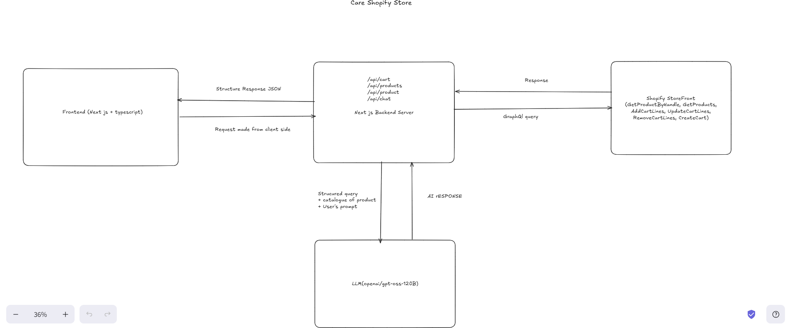

# Care Storefront — Project Architecture

## Project overview

Care is a responsive, headless Shopify storefront built with Next.js 16 App Router, React 19, and TypeScript. Shopify Storefront API is the source of truth for the product catalogue and cart. The storefront provides product discovery and detail pages, a persistent browser cart, Shopify-hosted checkout, and an optional Groq-powered shopping assistant.

The browser talks to same-origin Next.js route handlers for product-list and cart operations. Shopify credentials and the Groq API key are read only by server-side code and are not sent to client components.

## Architecture at a glance



## Features

- Shopify Storefront GraphQL products, images, price ranges, variants, and availability.
- Product detail pages with image gallery, variant selection, quantity controls, and cart drawer integration.
- Search, product-type filtering, and price sorting.
- Variant-aware cart with quantity controls, removal, item count, subtotal, and local browser persistence.
- Shopify cart creation and hosted checkout handoff.
- Optional AI shopping assistant for Shopify-catalogue recommendations, budget suggestions, and comparisons. Recommendation cards show verified product details and prices and can add selected variants to the cart; customer cart details and Shopify credentials are not sent to the AI.
- Loading, empty, configuration, and service-error states.

## Main components and responsibilities

| Area | Location | Responsibility |
| --- | --- | --- |
| App shell | `src/app/layout.tsx`, `src/app/globals.css` | Root metadata, global styles, responsive layout, and shared visual tokens. |
| Home/catalogue route | `src/app/page.tsx`, `src/components/storefront.tsx` | Loads the catalogue, filters and sorts products, owns page-level catalogue UI, and connects the header, product cards, cart drawer, and assistant. |
| Product card | `src/components/product-card.tsx` | Shows a catalogue item, links to its handle-based detail page, selects an available variant, and exposes add/quantity controls. |
| Product detail | `src/app/product/[id]/page.tsx`, `src/components/product-page.tsx` | Resolves the Shopify handle on the server; displays images, description, variant-specific price, quantity controls, and add-to-cart. |
| Cart | `src/components/cart-drawer.tsx` | Owns the active cart and cart ID, restores/persists that ID, performs cart mutations, and provides quantity, removal, subtotal, and checkout UI. |
| Chat | `src/components/chat-assistant.tsx`, `src/app/api/chat/route.ts` | Floating assistant UI; server fetches the Shopify catalogue, asks Groq for a grounded answer and product IDs, then the client renders matching catalogue products with add-to-cart controls. |
| Shopify integration | `src/lib/shopify.ts` | Shared server-side Storefront GraphQL request helper and catalogue/product queries. |
| Shared domain types | `src/types/store.ts` | Product, variant, money, and cart-line TypeScript types. |
| API handlers | `src/app/api/**/route.ts` | Server-side boundaries for catalogue, product, cart, checkout, and chat requests. |

## Request and state flows

### Product discovery and detail

1. `Storefront` requests `GET /api/products`.
2. The handler calls `getProducts()` in `src/lib/shopify.ts`, which requests the first page of products from Shopify.
3. Search, product-type filtering, and price sorting are performed in the client against the returned catalogue.
4. Product links use Shopify product handles. The dynamic product page calls `getProduct(handle)` server-side and calls `notFound()` if Shopify returns no product.

### Cart and checkout

1. `CartDrawer` restores the Shopify cart by reading `care-cart-id` from browser `localStorage` and fetching `GET /api/cart?cartId=...`.
2. Add, update, and remove operations are posted to `/api/cart`; the handler runs the corresponding Storefront cart mutation and returns the updated cart.
3. The drawer saves the returned cart ID in local storage and publishes current item count and per-variant quantities to the page. Product cards and the detail page use those quantities to display matching controls.
4. Checkout posts the cart ID to `/api/checkout`, which queries Shopify for that cart's `checkoutUrl`. The browser then navigates to Shopify-hosted checkout.

### Shopping assistant

1. The client sends only the shopper's current message to `/api/chat`.
2. The server fetches the Shopify catalogue, supplies available product and variant information to Groq, and requests structured JSON containing an answer and recommendation IDs.
3. The route filters recommendations against its fetched catalogue. The client resolves those IDs against the catalogue already displayed and uses its Shopify product/variant data for cards and add-to-cart.

## Key decisions
- **Same-origin API boundary:** the browser calls Next.js route handlers rather than contacting Shopify with a private credential.
- **Cart drawer as cart owner:** cart mutations and the persisted cart ID live in `CartDrawer`; pages expose a small ref interface for opening it, adding variants, or setting their quantities.
- **Handle-based product URLs:** readable Shopify handles fit a single dynamic route segment. The route fetches product data by handle instead of embedding Shopify global IDs, which contain `/`.
- **Verified recommendation details:** the model returns Shopify product IDs and reasons, while the client renders titles, images, prices, and variants from catalogue data rather than trusting model-generated product facts.
- **Hosted checkout:** the storefront hands the Shopify cart to Shopify checkout instead of implementing payment or order processing.
- **Simple UI state:** filtering and page interaction state are local React state; the project has no global state library or separate commerce database.

## Known limitations and follow-up areas

- **Catalogue pagination:** the listing query requests only the first 20 products and up to 10 variants per listed product. The detail query requests up to 100 variants. Stores with larger catalogues or more variants need pagination.
- **Chat context:** the API receives only the current message and catalogue, not earlier conversation turns. The UI displays prior messages, but the model does not have that history.
- **AI explanations:** prompts constrain Groq to the Shopify data and recommendation IDs are validated, but the natural-language answer/reason is generated text and is not independently fact-checked. Prices and product cards are rendered from Shopify data.
- **Cart persistence scope:** only the Shopify cart ID is stored in local storage. It is browser/device-specific, has no account-based cross-device sync, and restoration depends on that Shopify cart remaining valid.

## Setup

1. Copy `.env.example` to `.env`.
2. Set the Shopify store domain (for example, `your-store.myshopify.com`) and a Shopify **Storefront API** access token.
3. Set `GROQ_API_KEY` to enable the product-aware shopping assistant. `GROQ_MODEL` please select any model of your choice but it should be compatible with groq for example `openai/gpt-oss-120b`.
4. Run `npm install`, then `npm run dev`.

The `.env*` files are ignored by Git. Do not put secret values in `NEXT_PUBLIC_*` variables.

## Validation

```bash
npm run lint
npx tsc --noEmit
npm run build
```